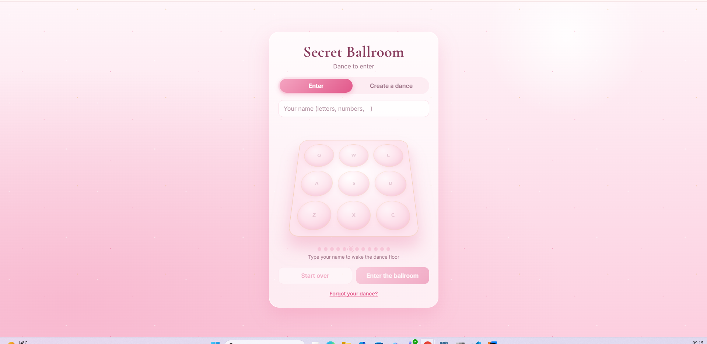
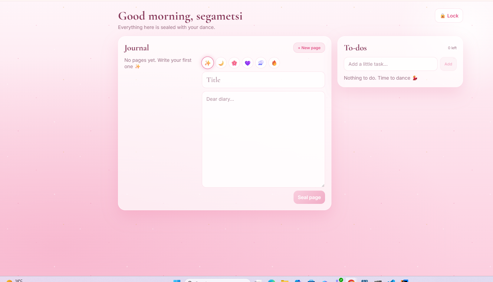
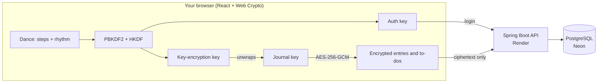

# Secret Ballroom 💃

**A private journal and to-do list that you unlock with a secret dance.**

Instead of typing a password, you dance on a floor of nine stepping stones. The server checks **which stones** you step on and **the rhythm** you dance them in. Everything you write is encrypted in your browser before it leaves your device, so the server, the database, and even I as the developer can only ever see scrambled text.

**Live app:** [secret-ballroom.vercel.app](https://secret-ballroom.vercel.app), installable on phone and laptop

<p align="center">
  
  
</p>

> The idea comes from the old Brothers Grimm fairy tale *The Twelve Dancing Princesses*, where a secret dance opens a hidden world.

---

## Features

- **Dance to unlock:** 6 to 12 steps on a 3 × 3 floor, by tapping or with the keyboard (`Q W E / A S D / Z X C`)
- **Rhythm is part of the password:** the right stones at the wrong tempo won't open the door
- **End-to-end encrypted journal** with moods, titles and editing
- **Encrypted to-do list:** add, tick off, delete
- **Recovery code:** a backup way in if you ever forget your dance
- **Installable app (PWA)** with its own icon, full screen on phone and laptop
- **Auto-lock** after 10 quiet minutes, after 2 minutes in the background, or when the session ends
- **Tamper detection:** if anyone edits a stored entry, the app refuses to open it

## Architecture



| Layer | Tech | Hosted on |
|---|---|---|
| Frontend | React, TypeScript, Vite, Web Crypto API, PWA | Vercel |
| Backend | Java 21, Spring Boot, Spring Data JPA, BCrypt, Docker | Render |
| Database | PostgreSQL | Neon (Frankfurt) |

## How the security works

### 1. Turning a dance into keys

The dance steps go through **PBKDF2-SHA256 with 600 000 rounds** (OWASP's recommendation), using a random salt. That's deliberately slow, so every guess an attacker makes costs real time. The result is split with **HKDF** into two independent keys:

| Key | Where it goes | Used for |
|---|---|---|
| **Auth key** | Sent to the server, which stores only a **BCrypt** hash of it | Proving it's you |
| **Key-encryption key** | **Never leaves the browser** | Unwrapping your journal key |

### 2. Envelope encryption

Your entries aren't encrypted with the dance directly. They're encrypted with a random **journal key** (AES-256-GCM), and that key is stored twice on the server, each copy **wrapped** (AES-KW) with a different secret:

```
              random JOURNAL KEY  (encrypts every entry)
                       │
         ┌─────────────┴──────────────┐
   wrapped with                 wrapped with
   your DANCE                   your RECOVERY CODE
```

This is the same design used by password managers and cloud key services. It means:
- **Recovery works:** the recovery code unwraps the journal key, and you choose a new dance
- **Changing your dance only re-wraps one key**, without re-encrypting the whole journal
- In the browser the journal key is **non-extractable**, so even malicious code on the page couldn't copy it out

The recovery code is 20 characters from a 32-letter alphabet (about 100 bits of randomness), shown **once** and never stored.

### 3. Encrypting entries

- **AES-256-GCM** with a fresh random IV on **every save**, so the same text never produces the same ciphertext twice
- GCM's built-in **authentication tag** detects tampering: change one character in the database and the entry refuses to open
- The record type (`entry` or `todo`) is bound in as **additional authenticated data**, so a to-do's ciphertext can't be swapped in as a journal entry

### 4. Login protections

| Protection | What it stops |
|---|---|
| **Same error for wrong steps and wrong rhythm** | Attackers learning which half they got right |
| **Lockout after 5 wrong tries** (dances or recovery codes) | Guessing online |
| **Fake but consistent salts for unknown names** | Discovering which usernames exist |
| **A dummy BCrypt check for unknown names** | Timing attacks that reveal whether a user exists |
| **Rhythm tolerance** (30%, at least 120 ms per gap) | Rejecting real people, who never dance like a metronome |

### 5. Sessions and API

- Session tokens are **256 random bits**. The database stores only their **SHA-256 hash**, so a leaked database can't be used to log in.
- Sessions expire after **1 hour**, and recovering an account **signs out every other device**.
- Every journal and to-do lookup filters by **owner**, preventing **IDOR** (changing an id in the URL to reach someone else's data). Other people's items return **404**, not 403, so the API doesn't even confirm they exist.
- Payloads are validated to look like real AES-GCM output (correct IV size, minimum tag length, maximum size).
- The key only ever lives **in memory**: refreshing the page locks the ballroom.

## Honest limitations

Knowing where a design is weak matters as much as building it.

- **Offline guessing.** If someone stole the whole database, they could try every possible dance offline, and the lockout and rhythm can't help there. PBKDF2 makes each guess slow, but the step space is small: 6 steps is about 531 000 combinations, while 10 steps is about 3.5 billion. **Longer dances matter.**
- **Rhythm isn't part of the encryption key.** Timing is fuzzy, so it can't feed into a key. It only protects the online login. The stored rhythm is readable on the server (it doesn't reveal the steps).
- **Rhythm across devices.** Thumb taps on a phone have a different tempo from key presses on a laptop, so a dance created on one device may be rejected on the other. Planned fix: compare the *shape* of the rhythm instead of its exact speed.
- **Lockout can be abused.** Someone who knows your username could lock you out for 5 minutes by failing on purpose. Per-IP rate limiting would help.
- **Trusting the website.** Like every browser-based encrypted app, you trust the server to deliver honest JavaScript. A compromised host could ship code that steals the dance.
- **Free hosting sleeps.** After 15 quiet minutes the API goes to sleep, and the first dance takes about a minute to wake it.

## API

| Method | Endpoint | Purpose |
|---|---|---|
| POST | `/api/dancers` | Create a dancer (auth key hash, salts, rhythm, both wrapped keys) |
| GET | `/api/dancers/{name}/salt` | Salt for turning the dance into keys |
| GET | `/api/dancers/{name}/recovery-salt` | Salt for the recovery code |
| POST | `/api/auth/login` | Steps + rhythm, returns a session and the wrapped journal key |
| POST | `/api/auth/recover/start` | Prove the recovery code, get the recovery-wrapped key |
| POST | `/api/auth/recover/finish` | Save a new dance wrapping the same journal key |
| POST | `/api/auth/logout` | End the session |
| GET, POST, PATCH, DELETE | `/api/entries`, `/api/entries/{id}` | Encrypted journal pages |
| GET, POST, PATCH, DELETE | `/api/todos`, `/api/todos/{id}` | Encrypted to-dos |
| GET | `/api/health` | Health check, also used to wake the server |

## Project structure

```
secret-ballroom/
├── sql/
│   ├── 01_schema.sql           dancers, journal entries, to-dos
│   ├── 02_sessions.sql         hashed session tokens
│   └── 03_recovery.sql         wrapped keys and recovery code
├── backend-ballroom/           Spring Boot API
│   ├── Dockerfile
│   └── src/main/java/com/hillary/ballroom/
│       ├── config/             CORS, auth interceptor, BCrypt
│       ├── controller/         REST endpoints
│       ├── dto/                request and response records
│       ├── model/              JPA entities
│       ├── repository/         Spring Data repositories
│       └── service/            auth, lockout, rhythm matching, validation
└── frontend/                   React + TypeScript PWA
    ├── public/                 manifest, service worker, icons
    └── src/
        ├── crypto/             key derivation, wrapping, AES-GCM, recovery codes
        ├── dance/              dance floor and rhythm recorder
        ├── ballroom/           journal, to-dos, door animation, auto-lock
        ├── LockScreen.tsx
        └── auth.ts             create, enter and recover flows
```

## Run it locally

**You need:** PostgreSQL, Java 21 and Node.js.

1. **Database:** create a database called `secret_ballroom` and run the three files in `sql/` in order.
2. **Backend:** open `backend-ballroom` in IntelliJ, set the environment variable `DB_PASSWORD` to your Postgres password, and run `BallroomApplication`. It starts on port 8082.
3. **Frontend:**
   ```
   cd frontend
   npm install
   npm run dev
   ```
   Open `http://localhost:5180`.

The encryption needs a secure context, so it works on `localhost` and HTTPS, but not on a plain `http://192.168...` address from another device.

## Deployment

| Setting | Where | Value |
|---|---|---|
| `DATABASE_URL`, `DB_USERNAME`, `DB_PASSWORD` | Render | Neon connection details (direct, not pooled) |
| `BALLROOM_PEPPER` | Render | A long random secret for the fake salts |
| `ALLOWED_ORIGINS` | Render | `https://secret-ballroom.vercel.app` (comma-separated) |
| `VITE_API_URL` | Vercel | `https://secret-ballroom.onrender.com/api` |

The backend runs in Docker as a non-root user. No secrets live in the code.

## What I'd add next

- Rhythm matching that compares the shape of the dance, not its speed, so it works the same on every device
- Unit tests for the rhythm matcher, the lockout and the crypto round trip
- Per-IP rate limiting to stop lockout abuse
- Search inside the journal (done in the browser, since the server can't read entries)
- Export: download a decrypted backup of your journal

---

Built by Hillary Itlhabanyeng
